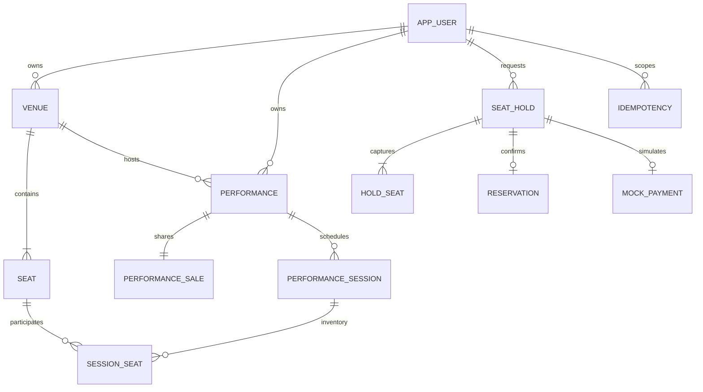

# V3 data ownership and integrity

Auth owns app_user; venue owns venue/seat; performance owns performance/performance_sale/performance_session; seat owns session_seat; reservation owns seat_hold/hold_seat/reservation; payment owns mock_payment. Global owns idempotency infrastructure. Foreign-module joins are projections, writes use the owning public service.

SessionSeat PRIMARY KEY(session_id,seat_id); Seat UNIQUE(venue_id,row_label,seat_number); PerformanceSale PRIMARY KEY(performance_id); Reservation UNIQUE(hold_id); MockPayment UNIQUE(hold_id) and UNIQUE(reservation_id); Idempotency PRIMARY KEY(user_id,operation,key), key case-sensitive, SHA256 request fingerprint. Foreign keys and indexed lookups preserve ownership references. Sale dates both null or both provided with end>start; price nonnegative integer KRW. State CHECK constraints restrict allowed states.

Flyway V1 original catalog is preserved. Additive V2 introduces booking tables and nullable owner/venue/description columns so old catalog data survives. Legacy records have no booking inventory and cannot be seller-managed; detail description is normalized to an empty string. Display aggregate prices on old performance columns are compatibility fields; new booking prices come from SessionSeat. No existing rows dropped/reset. Migrations are immutable after application.
