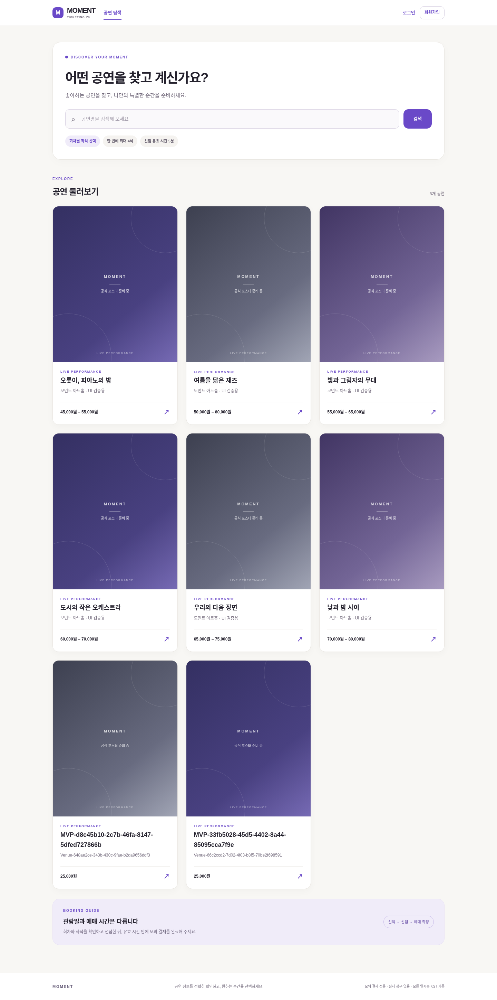

# Ticketing V3 프론트엔드 리디자인 검증 보고서

기준선: `dev@1b8912409aaafef37f09add9ce32aa97dc4a6199` (Issue #1 QA 포함). 작업일 2026-10-29 UTC. 기존 프로젝트를 복구한 독립 Worktree에서 작업했으며 기존 미커밋 변경사항은 삭제하지 않았다. 목표는 모의 결제 MVP를 보존하면서 구매자 탐색·예매와 판매자·관리자 운영 화면을 개선하는 것이다.

## 1. 실제 레퍼런스와 비교 근거

- **ticketing-service**: GitHub HTTPS Git으로 소스를 읽었다. main은 기본 화면뿐이었고 실제 디자인이 있는 `dev@18fc1fba1b4b6c0bbed5abcfb541c35d9ca5f334`를 분석했다. SiteHeader의 흰색74px 헤더/MOMENT/보라색 마크, PerformanceList의 검색 패널·배경, PerformanceCard의4:5포스터/모바일 가로 카드, 상세의 포스터+고정 회차 패널을 우선 반영했다.
- **ticketing-v2**: 실제 읽기 명령 `git ls-remote https://github.com/dongwanchoi/ticketing-v2.git HEAD`가403으로 거부됐다. V2 소스/화면의 장단점을 판단하거나 V2 요소를 반영했다고 주장하지 않는다.
- **ticketing-v3**: 원격 최신 dev의 QA 변경사항을 포함한 위 기준선에서 시작했다. API/DB/인증 정책을 디자인 참고 프로젝트의 정책으로 교체하지 않았다.
- 소스별 불변 GitHub 링크, 장단점, 선택·배제 이유는 [레퍼런스 분석](../design/reference-analysis.md)에 기록했다. 원본 두 저장소는 수정/Push하지 않았다.

실제 Chromium으로 레퍼런스5개 화면을 확인했다. 이는 원본 저장소의 frontend를 **일회성 실행 복사본**으로 추출하고, 해당 저장소가 제공한 읽기 전용 인메모리 fixture를 연결한 렌더링이다. 원본 서비스 DB·인증·예매 동작을 검증한 것은 아니다. V3 Before/After는 실제 V3 API/MySQL에 생성한 합성 공연6개를 사용했다. 공식 포스터 URL/장르/좌석 등급/판매 배지는 서버에 없으므로 만들지 않았다.

| 비교 | 장점 | 한계와 V3 선택 |
|---|---|---|
| ticketing-service/dev | 구매자 중심 검색, 포스터 비율, 차분한 보라색/오프화이트, 상세·회차 분리 | 예매 CTA 미구현, 다른 인증/카테고리 모델. 시각 구성만 선택하고 V3의 실제 예매 기능 유지 |
| V2 | 접근 불가로 미검증 | 추정/임의 재현하지 않음 |
| V3 Before | 실제 선점·결제·복원·권한/정합성 검증 | 로그인/긴 소개가 탐색을 밀어냄, 상세가 목록 아래 누적, 좌석/운영 정보 위계 부족 → 구조 재배치 |

## 2. 역할별 구현과 보존

| 역할 | Worktree / 브랜치 | 수행 결과 |
|---|---|---|
| 총괄 | `ticketing-v3-ui` / `feat/ui-redesign-v3` | 원격/원본 분석, Before/After 캡처, 실제 API fixture, 통합·오류·만료 E2E, 문서와 Git 통합 |
| Frontend | `ticketing-v3-ui-frontend` / `feat/ui-redesign-frontend` | 구매자 탐색/상세/회차/좌석/선점/결제/내역, 인증 Dialog, 운영 작업별 UI, 공통 컴포넌트/토큰, 단위 회귀 |
| Backend 검증 | `ticketing-v3-ui-backend` / `qa/ui-redesign-backend` | 변경 없는 백엔드를 별도 MySQL 스키마에서 재검증, 실제100명 경쟁/멱등성/권한, 불변 JAR 확보 |

Frontend·Backend 작업은 독립 브랜치/Worktree에서 수행했다. 재개 시 남은 Frontend 미커밋 수정은 총괄이 보존해 테스트·커밋한 후 통합했다. 역할 보고서: [Frontend](2026-10-29-ui-frontend.md), [Backend](2026-10-29-ui-backend-validation.md).

구매자: 공통 헤더와 집중된 인증 Dialog, 검색 중심 목록/포스터 카드, 상세/회차 선택, 서버 좌석 레이블 기반 행 그룹/무대/범례, 선택 좌석 합계,5분 선점 타이머/마지막1분 강조, 모의 성공·실패와 예매 내역. 선점 복원은 서버 목록을 명시적으로 선택하며 시간을 늘리지 않는다. 판매자: 공연장→공연→회차·판매 작업을 구분하고 하나의 공연을 선택해 관리한다. 관리자: 목록/선택 상세/실제 상태, 승인·반려 확인 Dialog를 사용한다. 취소/Escape는 API 호출 없이 닫힌다.

## 3. 구조와 의사결정

[디자인 시스템](../design/design-system.md)에 색상·간격·타입·반경·반응형·접근성 기준과 근거를 기록했다.

- 기존 Next/CSS를 유지했다. 새 UI 라이브러리는 의존성/번들 비용, 참고 frontend 통째 복사는 API/정책 회귀 위험이 있어 선택하지 않았다. CSS 재색칠만으로 해결되지 않는 탐색/예매/운영 구조를 분리했다.
- `ui.tsx`: Field/Panel/Notice/Poster/Status/Loading/Empty/Dialog. `workspace.tsx`: 헤더/역할 탐색/인증. `buyer.tsx`: 구성. `use-buyer.ts`: 기존 비동기 버전/멱등성 키/선점 복원 상태. `buyer-views.tsx`: 실제 화면. `seat-map.tsx`: 실제 레이블만 그룹화하며 식별 불가 시 원래 순서 유지.
- 1050/800/580px 경계, 검증 화면390/768/1440px. 좌석의 실제 행을 가짜 재배치하지 않도록 내부 좌석 캔버스만 스크롤 가능하다. 모바일 터치 타깃, 키보드 방향키/Home/End/Space, 가시 포커스, Dialog Tab 순환/Escape/포커스 복원과 배경 inert를 구현했다.
- 새 페이지 URL을 추가하는 대신 기존 단일 루트/로컬 뷰를 유지했다. 딥링크는 후속 개선 대상이며 주소 새로고침은 서버 활성 선점 복원 경로로 안전하게 처리한다.
- 공식 이미지/카테고리/판매기간 조회 값/반려 사유 필드가 없는 곳에 임의 데이터나 동작하지 않는 버튼을 추가하지 않았다. 기존 FAILED 결제 재시도 제한을 그대로 유지했다.

## 4. 발견 결함 및 최소 수정

1. **작은 보조 글자 대비**: `#817a89`/흰색은4.14:1. `#756d7e`로 변경해4.95:1(흰색),4.71:1(보조 표면),4.62:1(페이지 배경)을 확보했다. 실제 CSS 토큰을 읽는 대비 회귀 테스트를 추가했다. 전체 WCAG 인증을 의미하지 않는다.
2. **새 예매에 이전 결제 정보 노출**: 결제 완료 후 새 회차/좌석을 고르면 이전 CONFIRMED 선점/옛 금액이 새 선택 옆에 남았다. 표시 상태만 분리해 새 선택에서는 과거 결제 패널을 숨긴다. 실제 선점/결제/진행 중 멱등성 키는 유지한다. 다른 가격 선택→새 선점 응답 유실→같은 새 키 재시도 회귀가 통과했다.
3. **운영 설명의 구현 용어**: 사용자 안내에서 API 구현 표현을 제거하고 실제 작업/입력 제약으로 설명했다. 신규 정책을 도입하지 않았다.
4. **활성 선점 요약0석/0원**: 선점 성공 후 로컬 선택이 비워져 위쪽 요약과 서버 결제 패널이 달랐다. 동일 회차의 활성 선점 중에는 실제 서버 선점 좌석 수/목록/확정 금액을 표시한다. 다른 회차의 좌석 가격을 섞지 않으며 상태·정책 변경은 없다. 복원 단위 테스트와 실제2석 브라우저 검증으로 확인했다.
5. **E2E 검증 도구의 응답 읽기 실패**: 첫300초 실행은 기능/만료/재선점까지 통과했지만 최종 계약 집계에서 Chromium `Network.getResponseBody: No resource with given identifier found`가 발생해 실행 전체를 FAIL로 기록했다. 새로고침 직전 진행 중 응답을 `networkidle`로 기다리도록 조정하고 계약 실패 메시지에 method/path/status를 추가했다. 검증을 생략하거나 실패를 무시하는 fallback은 추가하지 않았다. 새 계정과 최종 빌드로 전체 실행을 반복했다.
6. 캡처 시 스크롤 위치에 고정 skip-link가 합성되는 아티팩트는 캡처 전에 상단으로 이동해 해결했다. 이는 실제 제품 결함으로 보고하지 않는다.

## 5. 실제 명령과 검증 결과

명령의 cwd는 해당 Worktree의 `frontend` 또는 `tests/integration`이다. 앱은 수정 없는 불변 JAR, MySQL8.4.7의 **분리된 `ticketing_v3_ui_app`**을 사용했다. 테스트는 `ticketing_v3_ui_test`를 사용했다. 기존 볼륨·앱 데이터·V1/V2 DB를 삭제/초기화하지 않았다.

| 명령 / 검증 | 결과 | 근거와 범위 |
|---|---|---|
| `npm test` | PASS **40/40** | 기존 QA assertions 유지, 새 Dialog/좌석/대비/새 결제 표시 회귀 포함 |
| `npm run typecheck` | PASS | 통합된 최종 코드 |
| `npm run build` | PASS | Next16 프로덕션 빌드. 초기 제한 sandbox의 TypeScript showConfig 해석 실패(FAIL) 후 정상 실행 환경에서 성공; 마지막 선점 요약 수정 후 재빌드도 성공 |
| Backend `gradle -p backend test bootJar --rerun-tasks --no-daemon --max-workers=2` + `V3_MYSQL_TEST=true` | PASS **15/15**, skip0 | 현재 작업에서 실제 MySQL 재검증. 상세 환경/도구는 Backend 역할 보고서 |
| 실제 인증 사용자100명 동일 좌석 경쟁 | PASS **1성공/99충돌** | HTTP 경쟁 후 실제 DB 최종 소유권/수량 확인. TPS/p95 보장 아님 |
| `node architecture.mjs` | PASS | Java36파일, 모듈 간 Repository 직접 의존/순환 없음 |
| `node ui-visual.mjs` | PASS **21화면** | 실제 Chromium→Next→Spring→MySQL.390/768/1440 본문 가로 넘침 없음, 인증/선택/HELD/BOOKED/복원/실패/내역/관리 확인 동작 |
| `V3_E2E_ACCOUNTS=<새 계정 파일> V3_QA_WAIT_EXPIRY=1 V3_UI_ARTIFACTS=<캡처 디렉터리> node mvp.mjs` | PASS | 최종 전체 실행 성공. 실제 판매자 등록/2회차/판매→관리자 승인→구매자 가입/로그인/선점/성공·실패/내역/새로고침 복원, 실제300초 만료→목록 제외→새 선점→해제. **99 API 응답 OpenAPI 일치** |
| `V3_E2E_ACCOUNTS=<동일 E2E 계정 파일> node network-qa.mjs` | PASS | 로딩/네트워크 중단/빈 검색/복구,403→401재인증,409재선택, 실제201커밋 후 응답 유실→같은 키 재시도, max4 |
| `node catalog.mjs` | PASS | 최종 실제8공연 응답/스키마/390px |
| 레퍼런스 렌더링 | PASS 5화면 | 저장소 제공 fixture 기반 시각 검토만 수행 |
| V2 소스/브라우저, 운영 HTTPS/실결제, 스크린리더 전체 인증 | BLOCKED(V2 403) / NOT RUN(나머지) | 완료로 주장하지 않음 |

앱 DB 읽기 전용 SQL 확인: BOOKED이지만 CONFIRMED 선점 없는 좌석0, 성공 결제 없는 예매0, 예매 없는 CONFIRMED 선점0, 예매 소유자/결제 금액 불일치0건이었다. 만료 E2E 완료 후 다시 실행한 [최종 SQL 결과](ui-redesign/db-consistency.tsv)도6가지 이상 수 모두0건, 예매3건이었다. 중복 회차·좌석 예매와 예매 좌석/합계 정합성까지 포함했다.

재현 가능한 최종 DB 확인: 저장소 루트에서 `docker exec -i ticketing-v3-catalog-mysql mysql -uroot -N ticketing_v3_ui_app < tests/integration/ui-consistency.sql`. 기존 분리 loopback fixture의 인증 방식이며 운영용 설정이 아니다. SQL은 읽기 전용이며6가지 이상 수가 모두0인지 확인한다.

네트워크 회귀의 오류는 의도적으로 주입했지만 성공 데이터는 실제 Backend에서 받았다. 단위 Mock 테스트만으로 통합 완료를 판단하지 않았다. 새 성능 TPS/p95 벤치마크는 NOT RUN; 이전 Issue #1의 제한된 잠금 측정은 [QA 보고서](2026-10-29-v3-qa.md)에 별도 기록되어 있다. 신규 Redis/Kafka/MSA를 추가하지 않았다.

## 6. 실제 화면과 시각 검토

[전체 캡처·측정 메타데이터](ui-redesign/)에 Before7 + 레퍼런스5 + 최종 After21 화면 및 실제 마지막1분 타이머 캡처을 보관한다. 합성 검증 계정/공연만 사용했고 비밀번호/세션/CSRF 토큰을 기록하지 않았다. `after-observation.json`에는 요청 경로/메서드/상태와 화면 폭만 남긴다.

| 화면 | Before | After |
|---|---|---|
| 탐색 desktop | [Before](ui-redesign/before-home-1440.png) | [After](ui-redesign/after-home-1440.png) |
| 탐색 mobile | [Before](ui-redesign/before-home-390.png) | [After](ui-redesign/after-home-390.png) |
| 상세 | [Before](ui-redesign/before-detail-1440.png) | [After](ui-redesign/after-detail-1440.png) |
| 좌석 mobile | [Before](ui-redesign/before-seats-390.png) | [After](ui-redesign/after-seats-390.png) |
| 판매자 | [Before](ui-redesign/before-seller-1440.png) | [After](ui-redesign/after-seller-venues-1440.png) |
| 관리자 | [Before](ui-redesign/before-admin-1440.png) | [After](ui-redesign/after-admin-1440.png) |

총괄은 최종 구매자 홈1440/좌석390/관리자1440/상세768/판매자768/선점390 등을 직접 이미지로 확인했다. 포스터 비율·오프화이트·검색 패널·보라색 선택과 운영 정보 구분을 검토했다. 원본 레퍼런스 렌더와 V3 원본/최종은 별도 캡처이며 소스 확인만으로 렌더 검증했다고 주장하지 않는다.

## 7. 로컬 재현

기본 실행 방법은 [runbook](../development-runbook.md). 이번 검증은 별도 UI 스키마를 사용한다.

1. 기존 `ticketing-v3-catalog-mysql`/볼륨을 확인한다. 새 환경에서 이 DB가 없다면 임의로 기존 데이터를 대체하지 말고 별도 fixture를 준비한다.
2. Java21, Node24, Chromium을 준비한다. `V3_DB_URL=jdbc:mysql://localhost:13306/ticketing_v3_ui_app?connectionTimeZone=UTC&forceConnectionTimeZoneToSession=true`와 안전하게 주입한 DB 인증값으로 변경 없는 V3 JAR를18080에 실행한다. 현재 불변 JAR SHA256은 `f866ba3e6ea9e5d05103e4b6dadadfcb8c6a3ccee92fdd82ba87826c740b8909`이며 `/workspace/shared/ui-redesign-runtime/`에 있다. 이 경로는 환경 보조 산출물로 Git에 포함하지 않는다.
3. `frontend`: `npm ci && npm test && npm run typecheck && npm run build && npm start`. 기본13000이며 동일 출처 `/api`를18080으로 프록시한다. backend override는 빌드 전에 설정한다.
4. `tests/integration`: `npm ci`. 새 `V3_E2E_ACCOUNTS=/tmp/<새 이름>.json`으로 `node prepare-accounts.mjs` 후 동일 DB 바인딩/`V3_BACKEND_JAR`로 `node provision-fixtures.mjs`. seller/admin만 신뢰 로컬 CLI로 신규 생성한다. buyer는 `mvp.mjs`에서 실제 UI 회원가입한다. 반복 실행 때 새 계정을 생성하고 기존 데이터는 보존한다.
5. 별도 시각 fixture는 `design-fixtures.mjs`를 사용한다. 이 스크립트는 신규 합성 공연/회차를 실제 API로 추가한다. `V3_DESIGN_FIXTURES`와 `V3_E2E_ACCOUNTS`를 명시하고 `ui-visual.mjs`를 실행한다. 시각 검증용 buyer는 사전에 가입되어 있어야 하며 E2E 가입용 새 buyer와 구분한다. 원본 레퍼런스 렌더를 띄우는 것은 V3 실행에 필요 없다.

## 8. 보존과 남은 결정

`git diff 1b89124 -- backend docs/api frontend/lib/api.ts frontend/lib/types.ts frontend/package.json frontend/package-lock.json`은 변경 없음. 신규 의존성/스키마/결제 정책을 추가하지 않았으며 main/V1/V2/원본 참고 저장소는 변경하지 않는다. 검증된 작업만 dev로 정상 Push한다. 환경 게시/운영 배포는 수행하지 않는다.

미확정: 승인 공연 회차 추가 후 재검수, 취소·환불·재판매·새 결제 재시도, 역할 전환/전체 선점 수량 정책. 임의로 확정하지 않았다. 공식 포스터·장르·공연장 실제 도면/좌석 등급·반려 사유·판매기간 조회 필드와 딥링크는 계약/요구사항 합의 후 개선 대상이다. 현재 좌석 배치는 레이블 기반 안내이며 실제 건축 도면을 재현한 것으로 주장하지 않는다. 운영 HTTPS·보안 설정·전체 접근성 감사·부하 보장은 별도 검증 대상이다.

## 9. Git 작업 이력

검증한 구현 통합 커밋: `69364e1`(Frontend 초기 리디자인), `13fc02d`(대비/토큰), `3857ea5`(새 선택과 이전 결제 표시 분리), `6f4eddc`(활성 선점 요약). 원래 Frontend 브랜치의 대응 마지막 커밋은 `5945301`, Backend 보고서 브랜치는 `75b0616`이다. 검증·캡처·문서는 추가 증거 커밋으로 통합한다.

원래 `/workspace/ticketing-v3`의 로컬 dev 및 미커밋 통합 파일은 그대로 보존했다. 따라서 해당 예전 체크아웃을 강제로 원격 dev로 바꾸지 않았다. 최신 코드의 로컬 확인은 `/workspace/ticketing-v3-ui`에서 수행한다. 원격 Push 결과는 최종 보고에 기록하며 강제 Push/main 변경/환경 게시를 하지 않는다.

완료 판정: 필수 UI 구현·최종 빌드·실제 브라우저 전체 E2E·실제300초 만료·최종 MySQL 정합성 검증 PASS. 초기 빌드/계약 집계 실패와 V2 접근 BLOCKED, 별도 미실행 항목은 위에 구분했다. 최종 화면21개에서 실제 API 관찰51건/화면 폭3종/본문 넘침0건을 기록했다.
